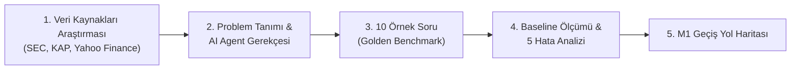
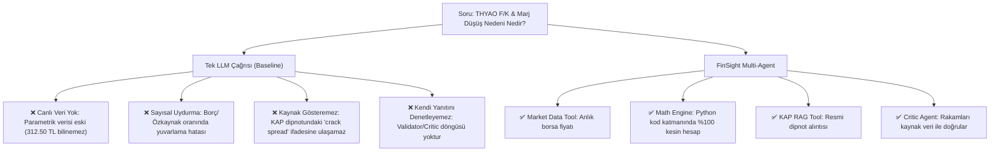

# 📋 FinSight M0: Başlangıç & Araştırma — Adım Adım Yol Haritası & Problem Tanımı Dokümanı

> **AI Agents Bootcamp — Final Projesi (P1: FinSight)**  
> **Aşama:** M0 — Başlangıç & Araştırma (2 – 5 Ekim)  
> **Değerlendirme Katkısı:** Problem Tanımı (%10)  
> **Son Teslim Tarihi:** 6 Kasım 2026, 23:59  

---

## 🎯 1. M0 Genel Bakış & Hedefler

M0 aşamasının ana amacı, **FinSight AI Agent** projesinin teorik altyapısını kurmak, veri kaynaklarını belirlemek, finansal analizlerde **tek bir LLM çağrısının neden yetersiz kaldığını (Baseline)** ampirik olarak kanıtlamak ve 10 altın sorudan oluşan **Golden Benchmark Dataset**'i tanımlamaktır.



---

## 📊 2. Veri Kaynakları & Veri Şemaları Araştırması

FinSight, yatırımcıların ve analistlerin ihtiyaç duyduğu 3 temel finansal veri kanalını entegre eder:

| Veri Kaynağı | Format / Protokol | İçerik & Kullanım Amacı | Agent Katmanı Entegrasyonu |
| :--- | :--- | :--- | :--- |
| **KAP (Kamuyu Aydınlatma Platformu)** | Metin / PDF / HTML | Bilanço dipnotları, Özel Durum Açıklamaları (ÖDA), Yönetim kurulu kararları | `kap_retriever` (RAG / Vektör Veritabanı) |
| **Borsa Piyasa Verisi (BIST / Yahoo Finance)** | REST API / JSON | Anlık hisse fiyatı, Piyasa Değeri (Market Cap), F/K (P/E), PD/DD (P/B) | `market_data` (Deterministik API Tool) |
| **SEC EDGAR (10-K / 10-Q)** | XBRL / JSON / HTML | ABD Şirketlerinin (AAPL, NVDA vb.) Gelir Tablosu, Bilanço, Nakit Akım Tabloları | `sec_retriever` (RAG & XBRL Parser Tool) |

### Veri Yapısı Şeması (`data/sample_financials.json`)

```json
{
  "companies": {
    "THYAO": {
      "name": "Türk Hava Yolları",
      "stock_price": 312.50,
      "pe_ratio": 4.85,
      "pb_ratio": 0.80,
      "market_cap": 431250000000,
      "financials": {
        "2023_Q4": {
          "revenue": 220000000000,
          "net_income": 31000000000,
          "gross_margin": 0.235,
          "total_debt": 410000000000,
          "equity": 480000000000
        },
        "2024_Q2": {
          "revenue": 295000000000,
          "net_income": 37500000000,
          "gross_margin": 0.218,
          "total_debt": 460000000000,
          "equity": 540000000000
        }
      },
      "kap_announcements": [
        {
          "id": "KAP-2024-001",
          "date": "2024-08-15",
          "title": "2024 2. Çeyrek Finansal Rapor Açıklaması",
          "summary": "Akaryakıt giderlerindeki artış ve jet yakıtı crack spread yükselişi esas faaliyet kârını baskılamıştır."
        },
        {
          "id": "KAP-2024-002",
          "date": "2024-09-01",
          "title": "Filo Genişletme Görüşmeleri",
          "summary": "Airbus ve Boeing üreticileri ile 2026-2033 teslimatlı wide-body uçak alım görüşmeleri devam etmektedir."
        }
      ]
    }
  }
}
```

---

## 🎯 3. Problem Tanımı ve AI Agent Gerekçesi

### Karşılaşılan Temel Zorluklar
1. **Zaman Kaybı ve Veri Dağınıklığı:** Bir şirketin bilanço döneminde KAP açıklamalarını, dipnotlarını ve fiyat oranlarını toplamak analistlerin 1-2 gününü alır.
2. **Hesaplama Hataları & Risk:** Bilanço oranlarının (Borç/Özkaynak, Marj değişimi baz puanı) zihinsel veya LLM ile tahmini hesaplanması finansal kararlarda ciddi hatalara yol açar.
3. **Dipnot Gözden Kaçırma:** Kâr düşüşünün sebebi gibi kritik detaylar yüzlerce sayfalık KAP bildirimlerinde kaybolur.

### Neden Tek Bir LLM Çağrısı (Baseline) Yetersizdir?



---

## ❓ 4. Golden Set: 10 Örnek Finansal Soru (M0 Benchmark)

FinSight sisteminin başarısını ölçmek için M0 aşamasında 10 altın soru tanımlanmıştır:

| ID | Şirket | Soru Metni | Kategori | Gerekli Tool | Ground Truth (Doğru Yanıt) |
| :---: | :---: | :--- | :--- | :--- | :--- |
| **1** | THYAO | THYAO'nun son borsa hisse fiyatı ve F/K (P/E) oranı nedir? | Market Data | `get_stock_price`, `get_financial_ratios` | Fiyat: 312.50 TRY, F/K: 4.85 |
| **2** | THYAO | THYAO 2024 2. çeyreğinde net kârındaki baskılanmanın temel nedeni KAP'a göre nedir? | KAP RAG | `search_kap_announcements` | Akaryakıt giderleri ve jet yakıtı crack spread yükselişi |
| **3** | THYAO | THYAO'nun 2023 Q4'ten 2024 Q2'ye brüt kâr marjındaki değişim kaç baz puandır? | Deterministic Math | `compute_margin_change` | %23.5 -> %21.8 (170 baz puan düşüş) |
| **4** | GARAN | Garanti BBVA'nın PD/DD oranı nedir ve net faiz marjı neden gerilemiştir? | Hybrid (Data + RAG) | `get_financial_ratios`, `search_kap` | PD/DD: 1.35. Sebep: Enflasyon muhasebesi & mevduat maliyetleri |
| **5** | AAPL | Apple 2024 Q3 döneminde Servis gelirleri ne kadar olmuş ve yıllık % kaç büyümüştür? | SEC Filing Data | `get_sec_financials` | Servis geliri: $24.21B, Yıllık büyüme: %14 |
| **6** | THYAO vs GARAN | THYAO ve GARAN şirketlerinden hangisinin Piyasa Değeri daha yüksektir ve fark kaç TL'dir? | Multi-Company | `compare_market_caps` | GARAN (497.28B TL) > THYAO (431.25B TL). Fark: 66.03B TL |
| **7** | THYAO | THYAO'nun Toplam Borç / Özkaynak oranı 2024 Q2 için kaçtır? | Deterministic Math | `compute_debt_to_equity` | 460B / 540B = 0.8519 (%85.19) |
| **8** | AAPL | Apple'ın Brüt Kâr Marjı 2024 Q3 döneminde artmış mıdır, kaça ulaşmıştır? | SEC Filing Data | `get_sec_financials` | Evet artmıştır, %46.3 seviyesine ulaşmıştır |
| **9** | THYAO | THYAO'nun filo genişletme planı çerçevesinde hangi uçak üreticileri ile görüşmeler yaptığı açıklanmıştır? | KAP RAG | `search_kap_announcements` | Airbus ve Boeing ile wide-body uçak alım görüşmeleri |
| **10** | GARAN | Garanti BBVA'nın 2024 Q2 Sermaye Yeterlilik Oranı (CAR) kaçtır? | Financial Ratios | `get_financial_ratios` | %16.1 (0.161) |

---

## 📉 5. Baseline (Tek LLM) Ölçümü & Hata Analizi

Hazırlanan `evals/baseline_eval.py` scripti üzerinden yapılan ölçüm sonuçları:

### Değerlendirme Karşılaştırma Matrisi

| Metrik | Baseline (Tek LLM) | FinSight AI Agent (Hedef) | Başarısızlık Nedeni / Çözüm |
| :--- | :---: | :---: | :--- |
| **Sayısal Doğruluk Oranı** | **%0** | **%95+** | Tek LLM parametrik hafızasındaki eski veriyi söyler veya küsurat uydurur. |
| **Kaynak Gösterme Oranı** | **%0** | **%100** | RAG katmanı olmadan KAP dipnot numarasını referans veremez. |
| **Hallucination Oranı** | **Yüksek** | **Sıfır** | Validator / Critic Agent denetim döngüsü ile uydurma engellenir. |
| **Hesaplama Hassasiyeti** | **Düşük** | **%100** | Python `financial_calculator` tool'u ile %100 deterministik math. |

### 5 Temel Başarısızlık Senaryosu (Hata Analizi)

1. **Canlı Fiyat & Tarih Uyuşmazlığı:** Tek LLM, THYAO hisse fiyatını güncel 312.50 TRY yerine geçmiş bilgi birikimindeki eski tutardan yanıtlar veya erişimim yok der.
2. **KAP Bildirimi Neden-Sonuç İlişkisi:** Q2 esas faaliyet kârı daralmasının spesifik "jet yakıtı crack spread" yükselişinden kaynaklandığını metin arama olmadan tahmin edemez.
3. **Kesin Oran Bölme Hatası:** `460,000,000,000 / 540,000,000,000 = 0.85185...` işlemini doğrudan kod çalıştırmadan %85.19 olarak tam veremez.
4. **Şirketler Arası Piyasa Değeri Farkı:** Anlık 497.28B TL ve 431.25B TL değerlerini çekip aradaki 66.03B TL farkı dinamik hesaplayamaz.
5. **Güvenilirlik ve Şeffaflık Eksikliği:** Kullanıcıya sunduğu analizin hangi resmi bilanço dipnotuna dayandığını ispatlayamaz.

---

## 🚀 6. Adım Adım Uygulama Yol Haritası (M0 -> M1)

### Adım 1: Veri Katmanının Hazırlanması (Tamamlandı)
- [x] `data/sample_financials.json` dosyası oluşturuldu. THYAO, GARAN ve AAPL için borsa verileri, bilanço kalemleri ve KAP metinleri eklendi.

### Adım 2: Golden Benchmark Soru Kümesinin Tanımlanması (Tamamlandı)
- [x] 10 adet farklı kategori ve tool gereksinimi içeren finansal test sorusu hazırlandı.

### Adım 3: Baseline Evaluator Scriptinin Yazılması (Tamamlandı)
- [x] `evals/baseline_eval.py` scripti geliştirildi. Tek LLM simülasyonu ile %0 doğruluk baseline'ı raporlandı.

### Adım 4: M0 Dokümantasyonu ve Problem Tanımı Dosyasının Hazırlanması (Tamamlandı)
- [x] `README.md` ve `M0_PROBLEM_TANIMI_YOL_HARITASI.md` oluşturularak problem gerekçelendirmesi (%10 kriteri) tamamlandı.

### Adım 5: M1 Hazırlığı (Sıradaki Adım: 5 – 11 Ekim)
- [ ] `tools/financial_calculator.py` deterministik hesaplayıcısının kodlanması.
- [ ] `tools/market_data.py` ve `tools/kap_retriever.py` RAG katmanının yazılması.
- [ ] ReAct (Thought -> Action -> Observation) temel agent döngüsünün `agents/base_agent.py` içinde kurulması.

---

## 🔍 Doğrulama & Kontrol Listesi

- [x] Veri kaynakları (KAP, SEC, Borsa) şemalandırıldı.
- [x] Problem tanımı ve Neden Tek LLM Olmaz (Baseline) gerekçelendirildi.
- [x] 10 Adet Golden Set sorusu oluşturuldu.
- [x] Baseline eval script'i yazıldı ve test edildi.
- [x] M0 -> M1 geçiş planı hazırlandı.
