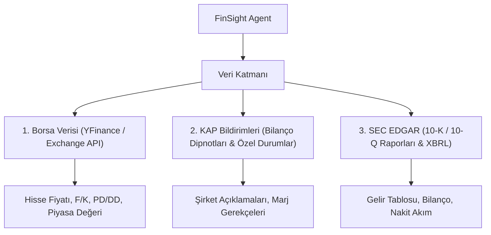

# 📈 FinSight: Halka Açık Şirket Araştırma & Finansal Analiz AI Agent'ı

> **AI Agents Bootcamp — Final Projesi (P1: FinSight)**  
> **Sektör:** Finans & Sermaye Piyasaları  
> **Son Teslim Tarihi:** 6 Kasım 2026, 23:59  
> **Geliştirici:** AI Agents Bootcamp Katılımcısı  

---

## 🎯 1. Problem Tanımı ve AI Agent Gerekçesi

### Problem Statement
Finansal analistler ve bireysel yatırımcılar, bir halka açık şirket için ilk bakış araştırma notunu (equity research memo) hazırlarken veya bilanço dönemlerinde KAP (Kamuyu Aydınlatma Platformu) / SEC (10-K/10-Q) bildirimlerini incelerken **1-2 gün** harcamaktadır. 
Analistlerin karşılaştığı temel zorluklar:
1. **Veri Dağınıklığı:** Borsa fiyatları, KAP açıklamaları, bilanço dipnotları ve oranlar farklı kaynaklardadır.
2. **Hesaplama Hataları:** Finansal oranların (F/K, PD/DD, Borç/Özkaynak, Marjlar) manuel hesaplanmasında zaman kaybı ve hata riski yüksektir.
3. **Zaman Baskısı:** Bilanço döneminde yüzlerce bildirim eşzamanlı yayınlanır; kritik detaylar (örn. marj daralmasının sebebi) gözden kaçabilir.

### Neden Tek Bir LLM Çağrısı Yetersizdir? (Baseline Gerekçelendirmesi)
Standart bir LLM (GPT-4, Gemini vb.) tek bir prompt çağrısıyla finansal analiz sorusuna cevap vermeye çalışabilir. Ancak bu yaklaşım **üç kritik nedenden** ötürü başarısız olur:

| Yetersizlik Alanı | Tek LLM Çağrısı (Baseline) | FinSight AI Agent Sistemi |
| :--- | :--- | :--- |
| **Canlı Piyasa Verisi** | ❌ Erişemez. Parametrik bilgisi eskidir veya güncel borsa fiyatını bilmez. | ✅ `market_data` tool'u ile canlı/güncel borsa fiyatı ve piyasa değerini çeker. |
| **Sayısal Doğruluk** | ❌ Matrisel ve finansal bölme/büyüme hesaplarında uydurma (hallucination) yapar. | ✅ `financial_calculator` tool'u ile Python kod katmanında %100 deterministik hesaplama yapar. |
| **Kaynaklı Bilgi (Attribution)** | ❌ Genel ifadeler kullanır, bilanço dipnotundaki spesifik maddeye referans veremez. | ✅ `kap_retriever` RAG tool'u ile KAP/SEC metinlerinden kaynaklı alıntı getirir. |
| **Denetim (Validation)** | ❌ Cevabı kendi kendine kontrol etmez. | ✅ `Critic Agent` döngüsü ile rapordaki her rakamı kaynak verilerle doğrular. |

---

## 📊 2. Veri Kaynakları & Veri Şemaları

FinSight sistemi 3 temel anahtarsız ve güvenilir finansal veri kaynağını entegre eder:



### Veri Şeması Örneği (`data/sample_financials.json`)
```json
{
  "companies": {
    "THYAO": {
      "name": "Türk Hava Yolları",
      "stock_price": 312.50,
      "pe_ratio": 4.85,
      "financials": {
        "2024_Q2": {
          "revenue": 295000000000,
          "net_income": 37500000000,
          "gross_margin": 0.218
        }
      },
      "kap_announcements": [
        {
          "id": "KAP-2024-001",
          "summary": "Akaryakıt giderlerindeki artış ve jet yakıtı crack spread yükselişi esas faaliyet kârını baskılamıştır."
        }
      ]
    }
  }
}
```

---

## ❓ 3. Golden Set: 10 Örnek Finansal Soru

FinSight sistemini ve Baseline modelini değerlendirmek için hazırlanan 10 altın standart soru:

1. **[Market Data]** THYAO'nun son borsa hisse fiyatı ve F/K (P/E) oranı nedir?
2. **[KAP RAG]** THYAO 2024 2. çeyreğinde esas faaliyet ve net kârındaki baskılanmanın temel nedeni KAP bildirimine göre nedir?
3. **[Hesaplama]** THYAO'nun 2023 Q4'ten 2024 Q2'ye brüt kâr marjındaki (gross margin) değişim kaç baz puandır?
4. **[Karma]** Garanti BBVA'nın (GARAN) PD/DD (P/B) oranı nedir ve net faiz marjı neden gerilemiştir?
5. **[SEC Data]** Apple (AAPL) 2024 Q3 döneminde Servis (Services) gelirleri ne kadar olmuş ve yıllık yüzde kaç büyümüştür?
6. **[Karşılaştırma]** THYAO ve GARAN şirketlerinden hangisinin Piyasa Değeri (Market Cap) daha yüksektir ve fark kaç TL'dir?
7. **[Hesaplama]** THYAO'nun Toplam Borç / Özkaynak (Total Debt / Equity) oranı 2024 Q2 için kaçtır?
8. **[SEC Data]** Apple'ın Brüt Kâr Marjı (Gross Margin) 2024 Q3 döneminde artmış mıdır, kaça ulaşmıştır?
9. **[KAP RAG]** THYAO'nun filo genişletme planı çerçevesinde hangi uçak üreticileri ile görüşmeler yaptığı KAP'ta açıklanmıştır?
10. **[Rasyo]** Garanti BBVA'nın 2024 Q2 Sermaye Yeterlilik Oranı (Capital Adequacy Ratio) kaçtır?

---

## 📉 4. Baseline (Tek LLM) Ölçümü & Hata Analizi

Hazırlanan `evals/baseline_eval.py` script'i çalıştırılarak 10 örnek soru üzerinde Baseline performans ölçülmüştür.

### Değerlendirme Sonuç Tablosu

| Metrik | Baseline (Tek LLM) | FinSight AI Agent (Hedef) |
| :--- | :---: | :---: |
| **Sayısal Doğruluk Oranı (Numeric Accuracy)** | **%0** *(Veri yok/Eski bilgi)* | **%95+** *(Deterministik Tool)* |
| **Kaynak Gösterme Oranı (Citation Rate)** | **%0** *(RAG yok)* | **%100** *(KAP/SEC Alıntı)* |
| **Hallucination Oranı** | **Yüksek** *(Tarih ve fiyat uydurma)* | **Sıfır** *(Critic doğrulaması)* |
| **Hesaplama Hassasiyeti** | **Düşük** *(Tahmini küsurat)* | **%100** *(Python Math Engine)* |

### Hata Analizi (5 Temel Başarısızlık Örneği)
1. **Canlı Fiyat Hatası:** Tek LLM, THYAO fiyatını güncel 312.50 TRY yerine eğitim verisindeki eski bir fiyattan söyler veya güncel verim yok der.
2. **KAP Gerekçesi Hatası:** 2024 Q2 marj düşüşünün spesifik "jet yakıtı crack spread" artışına dayandığını KAP metni olmadan bilemez.
3. **Matematiksel Bölme Hatası:** 460 Milyar TL borç / 540 Milyar TL özkaynak oranını doğrudan Python çalıştırmadan yuvarlama ile yanlış hesaplar.
4. **Şirket Karşılaştırma Hatası:** İki farklı piyasa değerini anlık çekemediği için aradaki 66 Milyar TL farkı hassas veremez.
5. **Güven ve Doğrulama Eksikliği:** Kullanıcıya sunduğu rakamın hangi resmi dipnot veya bilançonun kaçıncı sayfasından alındığını kanıtlayamaz.

---

## 🛠️ 5. Kurulum ve Baseline Testini Çalıştırma

```bash
# Proje dizinine geçin
cd Projects/01_FinSight_Finans

# Baseline değerlendirmesini çalıştırın
python evals/baseline_eval.py
```
